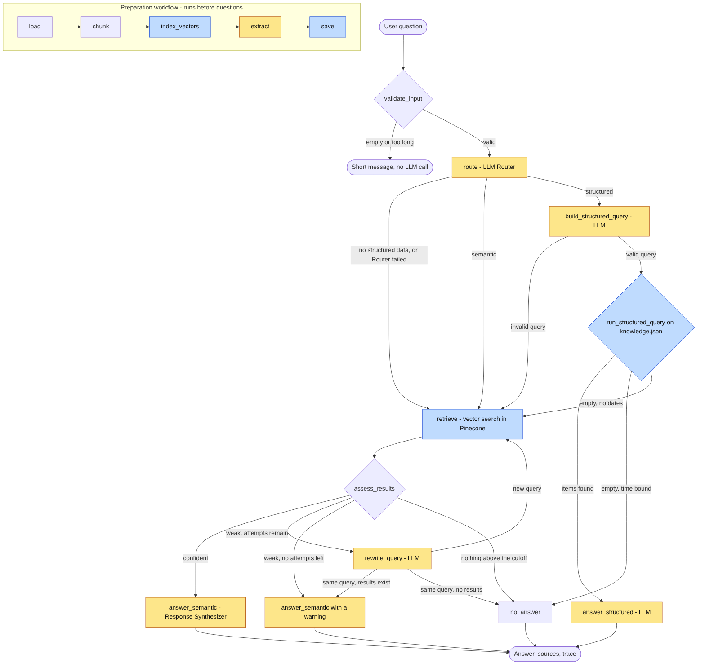

# תשאול התיעוד של כלי Agentic Coding (RAG)

כלים כמו Claude Code, Cursor ו-Kiro מנהלים תיעוד בקבצי md: הנחיות, מפרטים, תוכניות והחלטות. כל כלי שומר את הקבצים בתיקיות משלו, ולכן קשה לדעת מה בעצם נקבע בפרויקט.

הפרויקט סורק את הקבצים של כל הכלים, מאגד אותם לשכבת ידע אחת ומאפשר לשאול עליהם שאלות בצ'אט. הוא מתאים למי שרוצה להבין על מה הכלים מתבססים, וגם למתכנתים חדשים בצוות.

## איך זה עובד

המערכת בוחרת לכל שאלה את סוג החיפוש שמתאים לה:

| סוג השאלה | דוגמה | סוג החיפוש |
|---|---|---|
| הסבר או נושא מסוים | "איך מתקינים את המערכת?" | חיפוש סמנטי ב-Pinecone |
| רשימה מלאה, מצב עדכני או טווח זמן | "מה סומן כרגיש בשבוע האחרון?" | שאילתה מדויקת על נתונים מובנים |



בתרשים, צהוב מסמן שלב שקורא ל-LLM, וכחול מסמן שלב שניגש לנתונים. שאר השלבים הם לוגיקה רגילה בקוד.

## הטכנולוגיות

ספק המודלים נבחר אוטומטית: אם מוגדר `OPENAI_API_KEY` משתמשים ב-OpenAI, אחרת ב-Cohere (אפשר לכפות עם `LLM_PROVIDER`).

| תפקיד | כלי | הערה |
|---|---|---|
| Framework ו-Workflow | LlamaIndex | כולל Workflows מבוססי אירועים |
| Embeddings | OpenAI `text-embedding-3-small` / Cohere `embed-multilingual-v3.0` | שניהם רב-לשוניים ותומכים בעברית |
| LLM | OpenAI `gpt-4.1-mini` / Cohere `command-a-03-2025` | מהיר, זול ואמין בהחזרת JSON ובקריאת פונקציות |
| מסד וקטורי | Pinecone, או אחסון מקומי | בלי `PINECONE_API_KEY` הווקטורים נשמרים ב-`data/structured/vector_store/` |
| נתונים מובנים | קובץ JSON | `data/structured/knowledge.json` |
| ממשק | Gradio | צ'אט מימין לשמאל |

**מגבלות המסלולים החינמיים:**
- **Cohere:** 1,000 קריאות בחודש ו-20 קריאות צ'אט בדקה.
- **Pinecone:** עד 2GB ואזור `us-east-1` בלבד.

הקוד כולל השהיה בין קריאות, ניסיון חוזר כשמגיעים למגבלת קצב ושמירה של חילוצים קודמים, כדי לחסוך קריאות.

## התקנה והרצה

### 1. התקנה

נדרש Python בגרסה 3.10 ומעלה.

```bash
python -m venv .venv
source .venv/bin/activate        # ב-Windows: .venv\Scripts\activate
pip install -e ".[dev]"
```

ברשת NetFree יש להתקין גם את התוסף המתאים:

```bash
pip install -e ".[dev,netfree]"
```

### 2. מפתחות

1. יוצרים מפתח ב-[OpenAI](https://platform.openai.com/api-keys) (או ב-[Cohere](https://dashboard.cohere.com/api-keys)). מפתח [Pinecone](https://app.pinecone.io) הוא רשות.
2. מעתיקים את `.env.example` לקובץ בשם `.env`.
3. ממלאים בו את המפתחות.

הקובץ `.env` לא נכנס ל-Git.

כדי לוודא שהמפתחות עובדים:

```bash
python -m agentic_rag.check_services
```

### 3. הכנת הנתונים

הפקודה סורקת את הקבצים, בונה את האינדקס הווקטורי (ב-Pinecone, או מקומית אם אין מפתח) ומחלצת את הנתונים המובנים:

```bash
python -m agentic_rag.prepare
```

בנתוני הדוגמה זה לוקח כ-3 דקות וצורך כ-30 קריאות צ'אט. בהרצה חוזרת, קטעים שלא השתנו לא נשלחים שוב ל-LLM. אחרי שינוי בקבצים מריצים את הפקודה שוב, ואז מפעילים מחדש את הצ'אט.

### 4. הצ'אט

```bash
python -m agentic_rag.app
```

ואז פותחים את הכתובת שמופיעה במסך, בדרך כלל `http://127.0.0.1:7860`.

## דוגמאות לשאלות

**חיפוש סמנטי**
- איך מתקינים את המערכת?
- מה הצבע העיקרי שנבחר לדיזיין של המערכת?
- לאילו שפות הוחלט לתרגם את הכיתובים בממשק?
- האם קיימת מגבלה טכנית שחוזרת בכמה מסמכים שונים?

**נתונים מובנים**
- תן לי רשימה של כל ההחלטות הטכניות שהתקבלו בפרויקט.
- מה ההנחיה העדכנית לגבי שימוש ב-RTL בממשק?
- אילו שדות נוספו או הוסרו מטבלאות קיימות?
- האם נעשה שינוי במבנה ה-DB בחודש האחרון?
- אילו דברים סומנו כרגישים בשבוע האחרון?

שאלות עם טווח זמן נבדקות מול התאריך של היום, ותאריכי הדוגמה הם מסתיו 2026. בהרצה מאוחרת יותר אפשר לשאול על תאריכים מפורשים.

## הנתונים

| תיקייה | מה יש בה |
|---|---|
| `data/sample_project` | **נתוני דוגמה שנכתבו ידנית** בסגנון של Claude Code, Cursor ו-Kiro, על פרויקט בדיוני של גמ"ח ספרים |
| `data/spirit-of-kiro` | קובצי ה-steering האמיתיים של Kiro מקישור ה-Starter, ברישיון MIT-0 |

כדי לסרוק פרויקטים אחרים, מגדירים ב-`.env` תיקיות מופרדות בפסיקים:

```
DOCS_ROOTS=data/sample_project,data/spirit-of-kiro,C:/projects/my-project
```

כלי נוסף מוסיפים בשורה אחת ב-`TOOL_PATTERNS` שבקובץ `agentic_rag/sources.py`.

## שלבי המטלה בקוד

| שלב | קבצים |
|---|---|
| **א'** - טעינה וחיתוך | `sources.py`, `chunking.py` |
| **א'** - Embeddings ו-Pinecone | `services.py` |
| **א'** - Retrieve, Postprocess ו-Synthesize | `query_workflow.py` |
| **א'** - צ'אט | `app.py` |
| **ב'** - Workflow מבוסס אירועים | `query_workflow.py`, `ingest_workflow.py` |
| **ג'** - סכמה, חילוץ ואחסון | `schema.py`, `extraction.py`, `store.py` |
| **ג'** - ניתוב ושאילתה מובנית | השלבים `route`, `build_structured_query` ו-`run_structured_query` ב-`query_workflow.py` |

קוד שלב א' נכתב מחדש כ-Workflow בשלב ב', כפי שהמטלה מבקשת, ולכן אין לו קובץ נפרד.

מסמכים נוספים:
- [דיון בתכנון ה-Workflow](docs/design-discussion.md)
- [רפלקציה ומגבלות ידועות](docs/reflection.md)

## בדיקות

```bash
pytest
```

הבדיקות רצות בלי מפתחות ובלי רשת. הן משתמשות ב-LLM מדומה, ב-Embeddings מדומים וב-Pinecone מדומה, ומריצות את ספריית Cohere האמיתית מול שרת מקומי מזויף. לכן הן בודקות את הלוגיקה ואת מבנה הקריאות, אבל לא את איכות התשובות של המודל.
